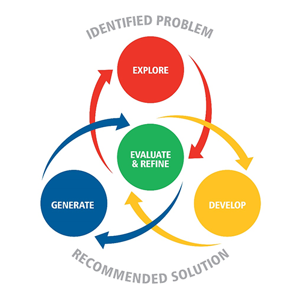

# Digital Solutions

:::{dropdown} Learning Goals
By the end of this section you will:
- understand what constitutes a digital solution
- understand the processes involved in creating a digital solution
:::

## What are Digital Solutions?

A digital solution is a functional system combining user interface, data and programming elements to address a defined real-world problem that meets human needs, wants or opportunities.

Its key features include:

- A **user interface** that allows meaningful interaction between the user and the system.
- **Programmed components** that use algorithms, control structures and data processing to perform the required functions.
- **Data components** such as databases or data stores that collect, validate, manipulate and display information.
- **Integration** of user, data and program elements into a single functional system.
- **Useability principles** that ensure accessibility, effectiveness, safety, utility and learnability.
- **Testing and refinement** to evaluate performance against success criteria and improve accuracy, maintainability, efficiency and user experience.
- **Consideration of personal, social and economic impacts**, including ethics, privacy and security.

## How do we create a Digital Solution?

We create a digital solution by following a structured problem-solving process. 

1. We **explore** a need, want or opportunity by analysing users, existing systems and constraints. Next, w
2. We **develop ideas** using design, systems and computational thinking to plan how the solution will work. 
3. We then **generate components**, including the user interface, programmed code and data structures, using suitable software and programming tools. 
4. Finally, we **evaluate and refine** the solution by testing it against success criteria, improving its performance, security and user experience until it meets the identified need.

This process is refered to as the EDGE problem-solving framework.

## Unit Repositories

Each unit of the course has its own GitHub repository (repo). The repo contains the files we need for that unit.

- [Unit 1 repo](https://github.com/DamoM73/digital-solutions-2025-unit-1)
- [Unit 2 repo](https://github.com/DamoM73/digital-solutions-2025-unit-2)
- [Unit 3 repo](https://github.com/DamoM73/digital-solutions-2025-unit-3)
- [Unit 4 repo](https://github.com/DamoM73/digital-solutions-2025-unit-4)

:::{danger} Fork the repo before we start
:class: dropdown
These repos belong to our teacher, so we can't save our changes to them. Before we start a unit, we need to make a **fork** of that unit's repo. A fork is our own copy of the repo, stored in our GitHub account. We can then clone the fork to our computer with GitHub Desktop and commit and push our work to it.

To make a fork, open the unit's repo on GitHub, click the **Fork** button in the top-right corner, then click **Create fork**.

If we don't have a GitHub account or GitHub Desktop yet, see [Technologies Used](./02_technologies_used.md#github).
:::
