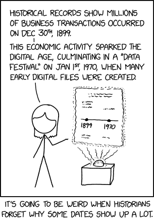

# Data Principles 📝

:::{dropdown} Learning Goals
By the end of this section you will:
- understand the issues involved in managing data, including acquisition, integrity, anomalies and security.
- understand data representation and how choices pertaining to it influence data.
:::

Data principles are fundamental guidelines that ensure data is collected, stored, processed, and used in ways that maintain its quality, reliability, and security.  

## Data Management 📝

Delivering a data-driven digital solution requires a detailed understanding of the data involved. Therefore it is vital to consider the data that underpins the application and issues related to managing that data.

These issues fall under four main categories:

- Data acquisition
- Data integrity
- Data anomalies
- Security and protection

### Acquisition 📝

Data acquisition is the process of collecting and capturing data from various sources and converting it into a usable digital format for further analysis and processing. In acquiring your data you need to consider both the timeliness of the data acquisition and the ownership of the data.

**Timeliness**

Data **timeliness** describes whether data is sufficiently current and available when needed for its intended purpose.

Timeliness requirements depend on how the data will be used. A school may need attendance records updated each lesson, while a live bus arrival application may need updates every few seconds. A delay that is acceptable for one purpose may make the data unsuitable for another.

In exploring the data needs of your solution, consider what delay there may be in your data acquisition, as well as how much delay can be tolerated.

**Ownership**

When acquiring data, consider the individuals, organisations and governments connected with it. The following categories provide useful examples:

- **Personal data:** information about individuals, such as names, addresses and contact details.
- **Corporate data:** data generated or collected by an organisation, such as sales records and financial data. It may also include personal information about customers or employees.
- **Public data:** data made available for public use, such as published census statistics. Check the licence and conditions of use; government-held data is not necessarily publicly available.

These categories can overlap and do not, by themselves, establish ownership or permission to use data. Identify who provides and controls the data, what permissions or licences apply, and any restrictions on its collection, storage and use.

### Integrity 📝

Data integrity means keeping data **accurate**, **complete**, and **consistent** at every stage&mdash;from creation and storage to processing and sharing. It ensures that the data remains **trustworthy** and **protected** from unauthorised changes, loss, or damage. This is especially important in fields like healthcare, finance, and research, where reliable data is essential.

In analysing the data for your solution you should consider both the integrity of the received data and the steps you need to take to ensure the ongoing integrity of that data.

Data integrity depends on the data being:

- **complete**: all required data is present
- **accurate**: the data correctly represents what it describes
- **kept up to date**: all changes to data occur in a timely manner
- **consistent**: the data follows agreed rules and does not contradict related records
- **secure**: the data is protected from unauthorised access or alteration and accidental loss or damage
- **relevant**: the data has meaning and use in the context of your solution

### Anomalies & Redundancy

**Data redundancy** occurs when the same fact is stored unnecessarily in multiple places. If these copies are not maintained consistently, data anomalies can occur when records are inserted, updated or deleted.

For example, suppose an enrolment table stores each student's name and contact details alongside each course enrolment. A student enrolled in several courses will have their details repeated in several records. This design can cause:

- **Insertion anomalies**: a new student's details cannot be recorded until they enrol in a course, unless incomplete or unnecessary enrolment data is added.
- **Deletion anomalies**: deleting a student's final enrolment also removes the only record of their contact details.
- **Update anomalies**: changing a student's contact details in only some enrolment records leaves conflicting copies.

Identifying and resolving these data anomalies is critical for maintaining data integrity in databases and ensuring that the data is accurate, complete, and consistent.

Proper database design, normalisation techniques, and data validation processes can help minimise the occurrence of data anomalies. We will learn about these techniques later in this Unit. For the purposes of the Explore phase, the prevention of such anomalies would form a requirement for your digital solution.

### Security and Protection

Security is essential to the success of any information system and the valuable data stored in it.  

**Threats**
The potential threats to your digital solution include:

- **malware:** software with malicious intent that can infect systems that serve a data-driven application. Malware examples include:
  - **viruses:** replicate itself by infecting other files and programs, causing damage to the system and potentially spreading to other devices.
  - **worms:** replicate itself and spread across networks, consuming bandwidth and causing system slowdowns or crashes.
  - **Trojan horses:** disguise themselves as legitimate software, tricking users into downloading and installing it, and then allowing unauthorised access to the system.
  - **ransomware:** encrypts files and demands payment in exchange for restoring access to them.
  - **spyware:** secretly monitors user activity and collects personal information, such as login credentials, credit card numbers, and browsing history.
  - adware: displays unwanted advertisements, often in the form of pop-ups or banners, and may redirect users to malicious websites.
  - **rootkits:** allow attackers to gain privileged access to a system, often remaining undetected and persistent even after system reboots or antivirus scans.
- **data theft and identity theft**: major concerns in relation to information systems and data-driven applications. Systems whose security measures become compromised can be mined for valuable, sensitive and private data.
- **invasion of privacy**: inadequate protection of data during access, storage or transmission can expose personal information and compromise privacy. Exposed information may be used for blackmail or unsolicited marketing.

**Solutions**
Steps can be taken to minimise the risks presented by the potential threats. These include:

- **user-level access control**: a security mechanism that limits the access of users to specific resources or functionalities within a database based on their roles or permissions. User-level access control can protect a database in several ways:
  - **limiting access** to sensitive data or functionalities to only those users who have a legitimate need to access them, thus reducing the risk of unauthorised access or data breaches
  - **enforcing policies** such as password requirements, access restrictions, or data retention policies, which can help to ensure compliance with regulatory requirements or internal guidelines
  - **monitoring and auditing user activities** within the database, such as logins, data queries, or modifications, which can help to detect and investigate potential security breaches or policy violations.
- **encryption**: transforms readable data into ciphertext using a key. Decryption restores the original data using the appropriate key. Encryption helps protect sensitive data during storage and transmission.
- **hashing**: produces a hash value from input data. Hashing is a one-way process: the hash cannot be decrypted to recover the original data. Ordinary hashing does not require a key. Passwords should be stored using a suitable password hashing algorithm with a unique salt, a value generated for each password. During login, a password verification function uses the stored salt and algorithm settings to check the entered password against the stored hash.
- **backup and disaster recovery**: maintain backups and, where supported, transaction logs to restore the database to an appropriate recovery point. Regularly test the recovery process.

:::{seealso} Data Management Activities
:class: dropdown

1. What two key factors should be considered during data acquisition?
2. How can personal, corporate and public data overlap? What permissions and conditions should be checked before using a dataset?
3. What does data integrity mean and why is it important for digital solutions?
4. What six qualities must data have to maintain integrity?
5. What is a data anomaly and how can it affect a database?
6. What are insertion, deletion, and update anomalies?
7. How can proper database design help reduce data anomalies?
8. What are some threats to the security of a data-driven application?
9. How does user-level access control help protect a database?
10. What is the difference between encryption and hashing when protecting data?
11. A school excursion database repeats each parent's phone number in several booking records. Explain one update anomaly this could cause and suggest how the database design could prevent it.
12. A bus arrival application receives location updates only once an hour. Explain why this may be unsuitable and suggest a more appropriate update frequency.
13. Why should a database recovery process be tested rather than relying only on the existence of backups?
:::

## Data Representation

**Data representation** describes how data, such as text and numbers, is encoded for storage and processing by a computer. Computers store data as bits, represented by 0s and 1s. Choices about representation affect storage requirements, processing and the values that can be represented.

### Text representation

**ASCII** represents a limited set of characters using numeric codes. For example, the uppercase letter 'A' has the decimal code 65. ASCII includes English letters, digits, punctuation and control characters.

**Unicode** assigns code points to characters from a much wider range of writing systems, as well as symbols and emoji. Like ASCII, it uses numeric values to identify characters. Encodings such as **UTF-8** define how Unicode text is stored as bytes.

Identify the encoding used by your data so that text can be read and exchanged correctly. Correct display also depends on software and font support.

### Other data representations

Distinguish the **stored value** from its **display format**. For example, 100,000 and $10^5$ express the same number. Likewise, a date may be displayed as `13/08/1984` or `1984-08-13` without changing the date it represents.

Before designing a database, choose suitable data types and consistent conventions for storing, exchanging and displaying each field. Phone numbers and postcodes are identifiers rather than quantities: storing them as text preserves leading zeros.

&nbsp;

The following examples describe display formats rather than formatting instructions for a particular programming language. Formatting symbols vary between tools, so check the documentation for the tool you are using.

| Data | Example display formats | Design consideration |
| --- | --- | --- |
| Dates | `13/08/1984`, `13/08/84`, `08/13/1984`, `1984-08-13` | Agree on the order of day, month and year. The ISO 8601 year-month-day format reduces ambiguity when exchanging dates. |
| Time | `13:15`, `01:15 pm`, `1:15 pm` | Choose a 12-hour or 24-hour display and include the time zone when needed. |
| Currency | `$12.50`, `AUD 12.50` | Specify the currency and required decimal precision. A dollar symbol alone may be ambiguous. |
| Identifiers | Mobile: `0412 345 678`; landline: `(07) 3123 4567`; postcode: `0800` | Store identifiers as text. Spaces and brackets can be added for display. |

For example, Python's `strftime` date and time formatting uses `%d` for the day, `%m` for the month, `%Y` for a four-digit year, `%H` for a 24-hour clock hour, `%I` for a 12-hour clock hour, `%M` for minutes, `%S` for seconds and `%p` for AM or PM. The format `%Y-%m-%d` produces a date such as `1984-08-13`. These symbols are specific to this formatting convention.

:::{seealso} Data Representation Activities
:class: dropdown

1. What does representation mean in the context of computer systems?
2. How does ASCII represent characters in a computer system?
3. Why is Unicode useful for modern digital solutions?
4. What kinds of characters can Unicode represent that ASCII cannot?
5. What is the difference between Unicode and UTF-8?
6. Why must data storage and exchange conventions be consistent?
7. What are two different ways the number 100,000 can be displayed?
8. Why should data types and formats be considered before designing a database?
9. What is the ISO 8601 year-month-day format for 13 August 1984?
10. How is time displayed differently in 12-hour and 24-hour systems?
11. Which Python `strftime` symbols represent months and minutes? Why is it important to distinguish them?
12. Why should a postcode such as `0800` be stored as text?
13. What is a common display format for an Australian mobile number?
14. How do a currency value and its display format differ?
15. A dataset contains the date `04/05/2025`. Explain why this is ambiguous and suggest a format that avoids the ambiguity.
:::
