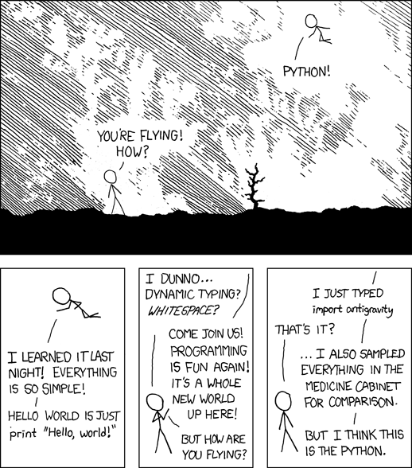

# Python Introduction

:::{dropdown} Learning Goals
By the end of this section you will:
- understand why Python is the programming language for this course
- know the Python skills we are expected to already have
- know where to refresh any skills we need to revisit
:::

## Why Python?

We have been using Python since Year 7, so it's fair to ask why we're sticking with it for Digital Solutions. There are plenty of other languages out there, but Python suits this course for several reasons.

### We build on what we already know

We've spent years learning Python. If we switched to a new language now, we would spend a large part of Year 11 relearning how to write variables, loops and functions in different syntax. Sticking with Python means we can spend that time on the new skills this course asks of us: designing solutions, working with data, building user interfaces and securing our programs.

### One language covers the whole syllabus

Digital Solutions asks us to create solutions that combine a user interface, data and code. Python lets us do all of this in one language:

- **user interfaces** → PyQt
- **databases** → SQLite with the built-in `sqlite3` module
- **data exchange** → JSON and XML
- **web services** → sending requests to APIs
- **data security** → ciphers, hashing and checksums

So rather than juggling several languages, we can focus on how the parts of our solution fit together.

### Readable code lets us focus on problem solving

Python's syntax is clean and close to plain English. Indentation shows the structure of our code, and there are no semicolons or curly braces to keep track of. This makes our code easier to read, debug and maintain, so we can put our effort into the problem we're solving rather than the rules of the language. It also makes it easier for our teachers, and for us in a few months' time, to understand what our code does.

### A huge library ecosystem

Python comes with a large **standard library**, and thousands more packages can be installed with `pip`. Whatever problem we're working on, there is a good chance someone has already written a library that helps.

### Free, cross-platform and well supported

Python is free and runs the same way on Windows and macOS, so our code works on whichever computer we use. It also has a large community behind it. That means official documentation, tutorials and answers to common problems are easy to find when we get stuck.

### It is used in industry

Python is consistently one of the most popular programming languages in the world. It is used for data science, artificial intelligence, web development, automation and cyber security. The skills we develop in this course carry straight over to further study and the workplace.

## Assumed knowledge

This text assumes we can already use the following Python skills:

- **core syntax** → variables, data types, input and output, and operators
- **control structures** → selection (`if`, `elif`, `else`) and iteration (`for` and `while` loops)
- **functions** → defining functions with parameters and return values
- **data structures** → lists, dictionaries and tuples
- **object-oriented programming (OOP)** → classes, objects and inheritance
- **virtual environments** → creating a `.venv` and installing packages with `pip`

:::{hint} Need a refresher?
:class: dropdown
If we need to revisit any of these skills, these sites cover them:

- core syntax, control structures and functions → [A Turtle Introduction to Python](https://damom73.github.io/turtle-introduction-to-python/)
- data structures → [Data Structures](../02_coding/02_basic_features.md#data-structures) in the Coding chapter
- object-oriented programming → [Deepest Dungeon - Python OOP](https://damom73.github.io/python-oop-with-deepest-dungeon/)
- virtual environments → [Virtual Environments](../01_introduction/02_technologies_used.md#virtual-environments) in Technologies Used
:::
