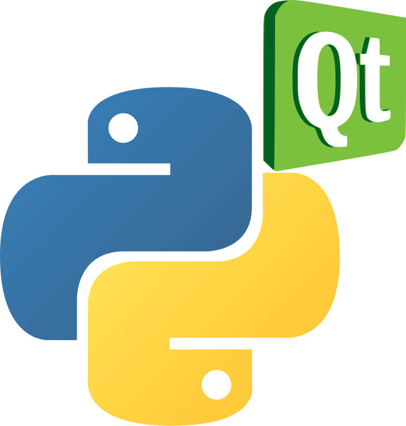

# PyQt

:::{dropdown} Learning Goals
By the end of this section you will:
- know what PyQt is and why we use it in this course
- know where to find the PyQt tutorials
:::

## What is PyQt?

**PyQt** is a Python library for building desktop applications with a **graphical user interface (GUI)**: windows, buttons, text boxes, menus and the other parts of an app that users see and click. It lets us use **Qt**, a widely used framework for building GUIs, from Python. We will be using **PyQt6**, the latest version.

PyQt works with **Qt Designer**, a drag-and-drop tool for laying out our user interfaces. We design what our app looks like in Qt Designer, and then write the Python code that makes it work.

## Why PyQt?

A digital solution combines a user interface, data and code. PyQt gives us the user interface part, so we can:

- build apps that run on Windows and macOS from the same code
- design our interfaces visually in Qt Designer, then apply the usability principles and visual communication we learnt in the User Experience chapter
- connect our interfaces to the rest of our solution, such as SQLite databases, CSV and JSON files, and APIs

## PyQt Tutorials

The PyQt tutorials have their own website. They start with setting up PyQt and Qt Designer, then work through building a series of apps: a calculator, a time machine, a to do list and a contacts app.

Click the logo below to go to the PyQt Tutorials site.

