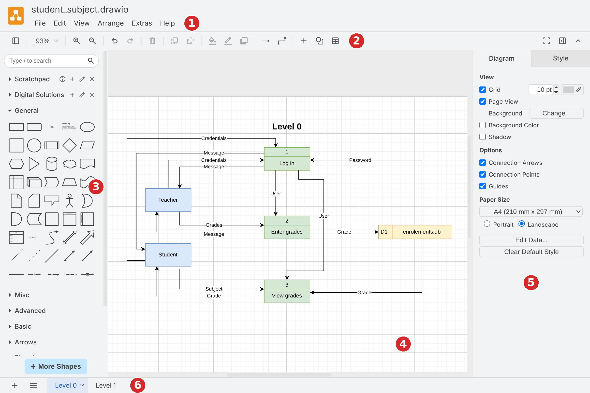
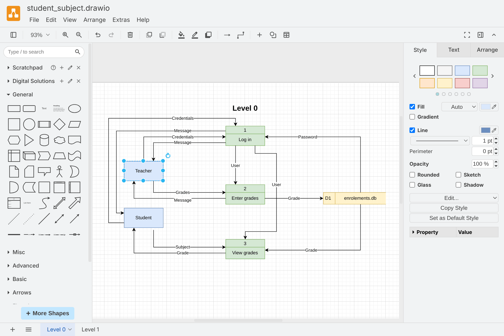
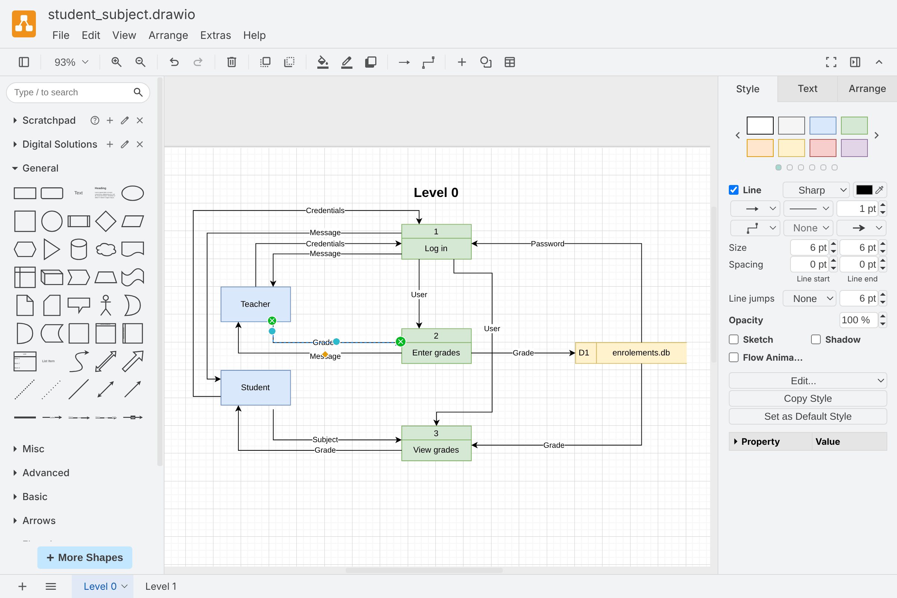
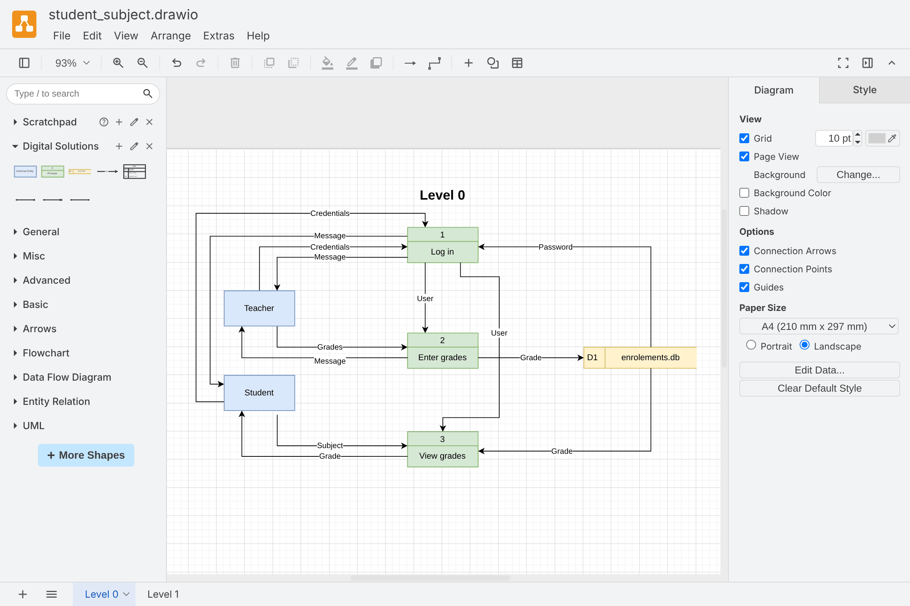
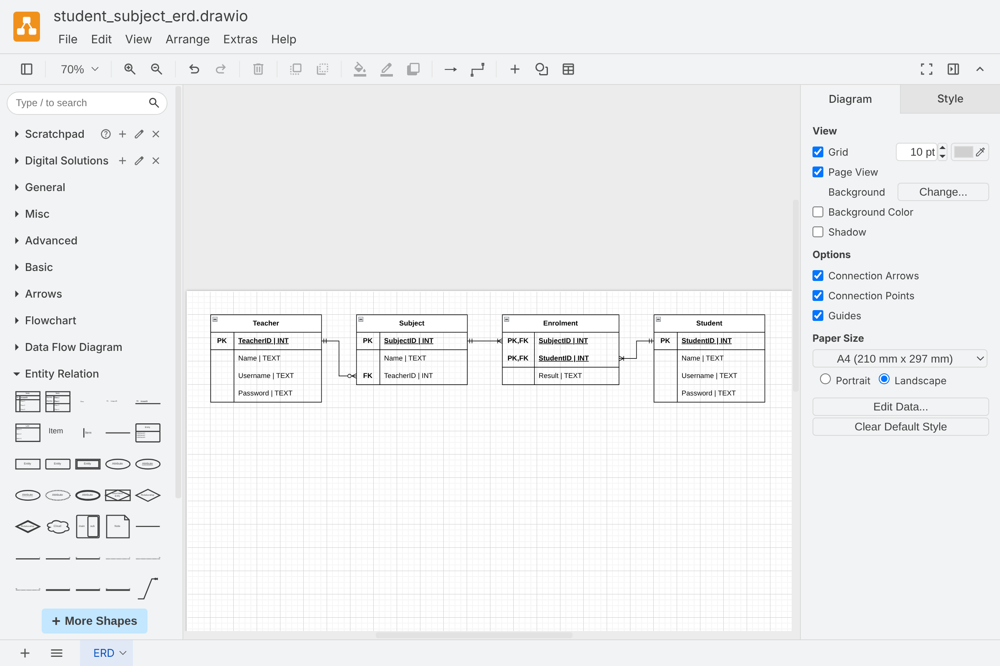
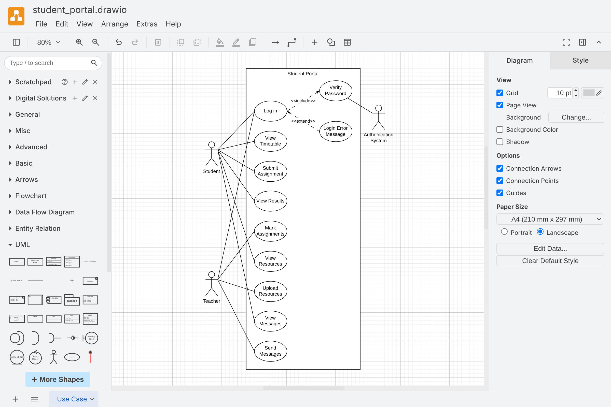

# Draw.io

:::{dropdown} Learning Goals
By the end of this section you will:
- know how to create, save and organise diagrams in draw.io
- know how to add, format and connect shapes
- know how to create data flow diagrams, entity relationship diagrams and use case diagrams using the course symbols
- know how to export diagrams for use in your assessment responses
:::

Draw.io (also called diagrams.net) is a free diagramming tool. We use it to create the diagrams in our documentation, such as data flow diagrams, entity relationship diagrams and use case diagrams.

Draw.io comes as a desktop app and an online version. Both work the same way. The instructions on this page use the desktop app, which saves diagrams straight into our project folders. See  to install it.

## The interface

1. **Menu bar** &rarr; file, edit, view and arrange commands, including saving and exporting
2. **Toolbar** &rarr; zoom, undo and redo, delete, and quick formatting buttons
3. **Shapes panel** &rarr; libraries of shapes to drag onto the diagram. Use the search box at the top to find a shape by name
4. **Canvas** &rarr; where we build the diagram. The grid helps us line up shapes
5. **Format panel** &rarr; settings for whatever is selected. With nothing selected, it shows settings for the whole diagram, such as the paper size
6. **Page tabs** &rarr; a diagram file can have several pages. Click **+** to add a page, and double-click a tab to rename it

## Creating and saving a diagram

:::{image} ./assets/04/file_menu.png
:alt: The File menu
:width: 300px
:::

1. Select **File › New...**. A new window opens with a blank diagram. If draw.io asks us to choose a template, choose **Blank Diagram** and click **Create**.
2. Select **File › Save as...**, choose a folder in our project, give the file a meaningful name, and click **Save**. Draw.io files have the `.drawio` extension.
3. Press **Ctrl + S** regularly to save our changes.

:::{tip} Keep diagrams with your project
:class: dropdown
Save diagram files in our project folder, for example in a `docs` folder in our repository. That way they're backed up when we commit and push to GitHub, and they're easy to find when we need to change them.
:::

:::{hint} One file, many pages
:class: dropdown
Use pages to keep related diagrams together. For example, one file can hold the Level 0 and Level 1 data flow diagrams on separate pages, as shown in the page tabs above.
:::

In Australia we print on A4 paper. With nothing selected, change the **Paper Size** in the Format panel to **A4**, and choose **Portrait** or **Landscape** to suit the diagram.

## Working with shapes

### Adding shapes

To add a shape, click it in the Shapes panel, or drag it onto the canvas. To add text to a shape, double-click it and start typing.

### Formatting shapes

When we select a shape, the Format panel shows three tabs:

- **Style** &rarr; fill colour, line colour and thickness, and effects such as rounded corners and shadows
- **Text** &rarr; font, size, colour and alignment of the text
- **Arrange** &rarr; position, size, and tools to align or distribute several shapes

:::{tip} Copy a style
:class: dropdown
To make several shapes look the same, select a shape that is already formatted, click **Copy Style** in the Style tab, select the other shapes, and click **Paste Style**.
:::

### Connecting shapes

When we hover over a shape, blue arrows appear on each side. Drag an arrow to another shape to connect them, or click an arrow to add a new connected shape. The small blue crosses are connection points, where we can attach a connector to an exact spot.

:::{image} ./assets/04/connection_arrows.png
:alt: Connection arrows and points on a shape
:width: 480px
:::

Connectors stay attached when we move the shapes. To add a label to a connector, double-click it and type. When we select a connector, the Format panel shows its settings, including:

- the line pattern and thickness
- the waypoints, which set whether the connector is straight, curved or has right angles
- the line start and line end, which set the arrowheads

### Useful shortcuts

| Shortcut | Action |
| --- | --- |
| Ctrl + S | Save |
| Ctrl + Z | Undo |
| Ctrl + Shift + Z | Redo |
| Ctrl + D | Duplicate the selected shapes |
| Ctrl + G | Group the selected shapes |
| Ctrl + Shift + U | Ungroup |
| Ctrl + Shift + H | Fit the diagram in the window |
| Delete | Delete the selected shapes |

## Diagrams for this course

### Adding shape libraries

Draw.io has libraries of shapes for different types of diagrams. Only some are shown by default. To add more:

1. Click **+ More Shapes** at the bottom of the Shapes panel.
2. Tick **Data Flow Diagram**, **Entity Relation** and **UML**.
3. Click **Apply**.

:::{image} ./assets/04/more_shapes.png
:alt: The Shapes dialog
:width: 560px
:::

### The Digital Solutions library

This course uses specific symbols for data flow diagrams and entity relationship diagrams. To save time, download the Digital Solutions library, which has all of them ready to use:

{download}`Digital Solutions library <./assets/04/digital_solutions_library.xml>`

To open it, select **File › Open Library...** and choose the downloaded file. The library appears in the Shapes panel as **Digital Solutions**.

The library contains:

- **External Entity**, **Process**, **Data Store** and **Data Flow** for data flow diagrams
- **ERD Table** and the **One to Many (mandatory)**, **One to Many (optional)** and **One to One** relationships for entity relationship diagrams

:::{hint} Make your own library
:class: dropdown
We can add our own shapes to a library. Select a shape on the canvas and drag it onto the library in the Shapes panel. Click the pencil icon beside the library name to edit or save it. The **Scratchpad** works the same way, for shapes we want to reuse.
:::

### Data flow diagrams

1. Drag an **External Entity** onto the canvas for each source or destination of data, and name it.
2. Drag a **Process** for each process. Double-click the top section to enter its number, and the bottom section to enter its name.
3. Drag a **Data Store** for each data store. Enter its ID (for example, D1) and its name.
4. Connect the shapes using the connection arrows, then double-click each connector to label the data that flows along it.
5. Add a new page for each Level 1 diagram.

The **Level 0** page of the Student Subject Database data flow diagram is shown above. See  for how to plan a data flow diagram.

### Entity relationship diagrams

1. Drag an **ERD Table** onto the canvas for each entity.
2. Double-click the table's heading to name the entity.
3. Double-click each row to enter the key (PK or FK) and the attribute's name and data type.
4. To add or remove rows, select a row, click the **Table** button in the toolbar, and choose **Insert Row After** or **Delete Row**.
5. Connect the tables with a relationship connector, from the primary key of one table to the matching foreign key in the other. Use the line start and line end in the Format panel to set the correct cardinality.

The **Entity Relation** library also has tables and relationship connectors. See  for how to plan an entity relationship diagram.

### Use case diagrams

The **UML** library has the symbols for use case diagrams:

- an **Actor** (the stick figure) for each user or external system
- a **Use Case** (the ellipse) for each action
- a rectangle from the **General** library for the system boundary

Connect actors to use cases with plain lines. For `<<include>>` and `<<extend>>` relationships, use a dashed arrow and label it.

See  for how to plan a use case diagram.

## Exporting diagrams

To use a diagram in a document, we export it as an image.

1. Select **File › Export as › PNG...**.
2. Set the options, then click **Export**.
3. Choose where to save the image, and click **Save**.

:::{image} ./assets/04/export_menu.png
:alt: The Export as menu
:width: 420px
:::

:::{image} ./assets/04/export_png.png
:alt: The PNG export options
:width: 320px
:::

| Option | Recommended setting |
| --- | --- |
| Zoom | 200%, so the image stays sharp when it is resized in a document |
| Border Width | 10, so the diagram isn't cut off at the edges |
| Size | Diagram, to export everything on the current page. Choose Selection Only to export just the selected shapes |
| Transparent Background | Off, so the diagram has a white background in the document |
| Include a copy of my diagram | On |

:::{important} Keep your diagrams editable
:class: dropdown
When **Include a copy of my diagram** is ticked, draw.io stores the diagram inside the PNG file. We can open the PNG in draw.io with **File › Open...** and keep editing it.

Even so, always keep the `.drawio` file. If a diagram needs changing after we receive feedback, we can update it and export it again, rather than drawing it from scratch.
:::

:::{hint} SVG and PDF
:class: dropdown
**SVG** images stay sharp at any size, and work well in web pages and in some word processors. **PDF** is useful for printing large diagrams. Both are in the **File › Export as** menu.
:::
