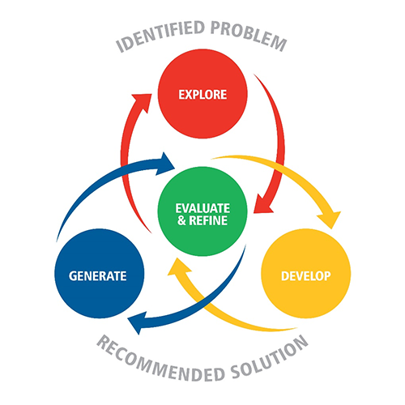

# Assessments Introduction

:::{dropdown} Learning Goals
By the end of this section you will:
- know the assessments in each unit of the course
- understand how the assessments contribute to your subject result
- know the conditions and expectations that apply to all the assessments
:::

## The assessment program

Digital Solutions has four units. Units 1 and 2 are studied in Year 11, and Units 3 and 4 are studied as a pair in Year 12.

| Unit | Assessment | Technique |
| --- | --- | --- |
| Unit 1 Creating with code |  | Technical proposal |
| Unit 1 Creating with code |  | Digital solution |
| Unit 2 Application and data solutions |  | Digital solution |
| Unit 2 Application and data solutions |  | Examination |
| Unit 3 Digital innovation |  | Technical proposal |
| Unit 3 Digital innovation |  | Digital solution |
| Unit 4 Digital impacts |  | Digital solution |
| Unit 4 Digital impacts |  | Examination |

The Year 11 assessments (FIA1, FIA2, FIA3 and the Unit 2 exam) use the same techniques as the Year 12 assessments. They give us practice at each type of assessment before it counts towards our final result.

## How the assessments count

### Units 1 and 2

The school reports our results for Units 1 and 2 to the QCAA as satisfactory or unsatisfactory. These results don't contribute to our final subject result, but they do show whether we've met the requirements of each unit.

### Units 3 and 4

Our final subject result comes from four assessments, each worth 25%.

| Assessment | Marked by | Weighting |
| --- | --- | --- |
| IA1: Technical proposal | Our school, then confirmed by the QCAA | 25% |
| IA2: Digital solution | Our school, then confirmed by the QCAA | 25% |
| IA3: Digital solution | Our school, then confirmed by the QCAA | 25% |
| EA: Examination | The QCAA | 25% |

Our teachers mark the three internal assessments (IA1, IA2 and IA3) using the instrument-specific marking guides (ISMGs), and send the marks to the QCAA. The QCAA checks samples of student work from each school to confirm the marks. The external assessment (EA) is set and marked by the QCAA, and every school in Queensland sits it at the same time on the same day.

The QCAA combines the four results into a mark out of 100 and an A–E result.

## Types of assessment

### Technical proposal

FIA1 and IA1

A technical proposal presents a plan for a digital solution to a technical audience. We investigate the problem, design a solution and build a low-fidelity, non-coded prototype, then present it as a multimodal presentation of up to 10 minutes.

### Digital solution

FIA2, FIA3, IA2 and IA3

A digital solution is a working, coded prototype. We determine success criteria, design and build the solution, then test it, gather user feedback and evaluate it. We submit a written and visual response of up to 10 A4 pages, and a video of up to 2 minutes demonstrating the prototype.

### Examination

The Unit 2 exam and the EA

An examination tests our knowledge and skills under exam conditions, using multiple choice, short response and extended response questions. Many questions refer to stimulus material, such as scenarios, tables and diagrams.

## The problem-solving process

Every technical proposal and digital solution follows the problem-solving process.

| Phase | What we do | Technical proposal | Digital solution |
| --- | --- | --- | --- |
| Explore | Analyse the problem, the users and the data, and determine success criteria | ✓ | ✓ |
| Develop | Design the user interface, data and programmed components | ✓ | ✓ |
| Generate | Build the prototype | Non-coded prototype | Coded prototype |
| Evaluate and refine | Test the solution, gather feedback, evaluate it and recommend improvements | | ✓ |

The documentation tools for each phase are explained in the  section.

## Expectations for all assessments

### Marking criteria

Each assessment is marked against criteria using an instrument-specific marking guide (ISMG). Each assessment page explains which parts of our response provide evidence for each criterion, so we know where the marks come from.

:::{hint} Use the descriptors
:class: dropdown
Read the ISMG before starting each assessment. The words that separate the mark ranges, such as *astute*, *logical* and *reasonable*, describe the quality the markers are looking for. The "Check your work" questions on each assessment page are based on these descriptors.
:::

### Response limits

Each assessment has a length limit, such as a number of minutes, pages or words. Plan the response to fit within the limit from the start, rather than cutting it down at the end.

For digital solutions, raw evidence such as full code, test results and survey data goes in the appendix. Markers can't use the appendix when marking, so all the analysis and evaluation must be in the body of the response. See  for what counts towards the limits.

### Checkpoints

Each assessment has checkpoints where our teacher checks our progress. Bring the work listed for each checkpoint. Checkpoints are our chance to get feedback before it's too late to act on it.

### Academic integrity

Our work must be our own. For every assessment:

- acknowledge all sources, including images, datasets, code and existing solutions, using APA referencing
- complete our work in class where our teacher can see our progress
- submit the work required at each checkpoint, including drafts
- sign a declaration of authenticity

Each assessment page covers the details of the assessment. Read the task sheet carefully as well, because it has the context, stimulus and dates for that assessment.
